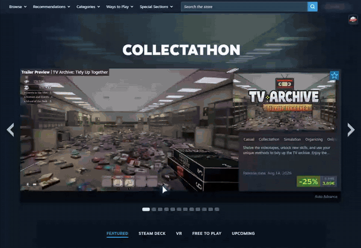
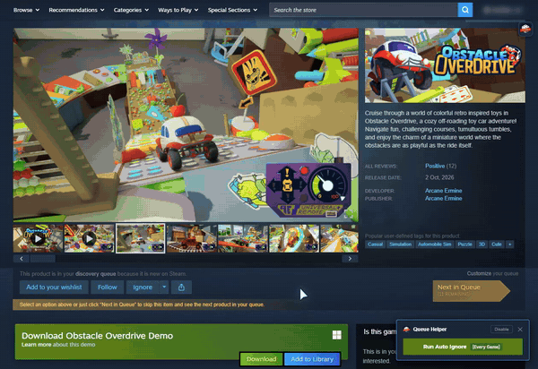
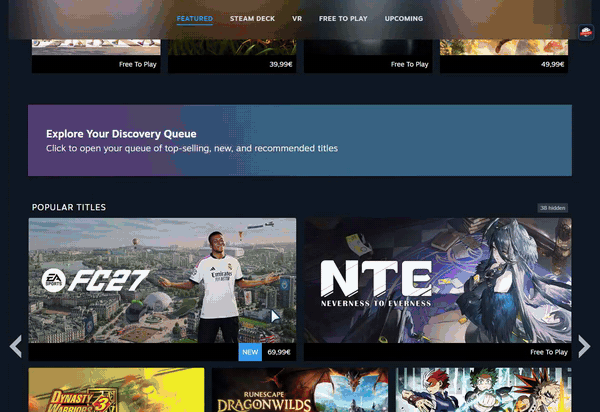
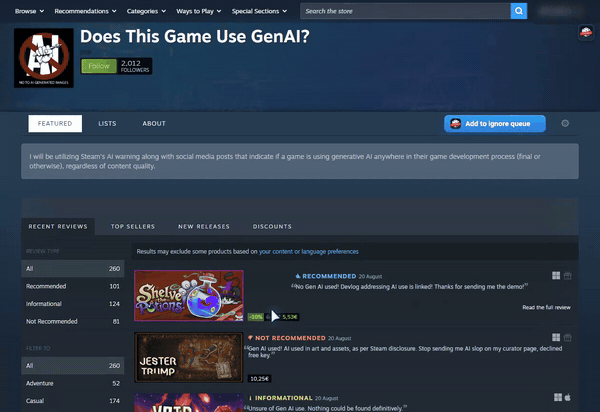

# Steam Ignore Like A Pro

### Ignore Steam games with a gesture, a hotkey, or let the queue helpers do it for you.

**Works on any Steam Store page.**

&nbsp;

**[Website](https://steamignorelikeapro.com) · [Changelog](CHANGELOG.md)**

[What it does](#what-it-does) · [Automation helpers](#automation-helpers) · [Privacy](#privacy) · [Install](#install) · [FAQ](#faq)

 

---

A browser extension that lets you ignore Steam games straight from the storefront. **Steam Ignore Like A Pro** turns ignoring into a single gesture or hotkey, available on every Steam Store page.

Steam's native ignore is missing from many widgets and requires multiple clicks. Steam also lacks an "Already Played" feature outside of the game's full store page, and offers no way to automate ignoring during feed browsing. This extension allows this.

## What it does

Hold the right mouse button  over any game capsule and draw a gesture:

| | Gesture | Result |
|---|---|---|
| **Ignore** |  + swipe right | A red badge  on each appearance of the game on the page, and Steam is asked to **ignore** the title. |
| **Already Played** |  + swipe left | For games you played on other platforms. A blue badge , and Steam stops suggesting the title while **keeping** your recommendations relevant. |
| **Un-ignore** |  + circle (either direction) or quick zigzag, or just click the IGNORED badge | The badge comes off and Steam un-ignores the game. This is applied as a real rollback. |

You can freely switch any of them to hold <kbd>Ctrl</kbd>, <kbd>Shift</kbd> or <kbd>Alt</kbd> +  click, or to draw a circle, instead of swiping.

## Panel & history

- **Quick Settings** - Customize gestures or hotkeys, configure ignore modes to suit your browsing style, and toggle specific features or the entire extension directly from the panel.
- **Last Ignored** - View your recently ignored game titles instantly from the extension panel. This is just the extension's own local log.
- **Bulk Un-ignore** - The **Undo** button in the panel rolls back everything from the last N hours or days, or the last N titles, without hunting down each store page. It also reaches games the per-game gesture can't, such as ones ignored in another tab or by the queue automators, and is paced by the same rate limiter as the ignores.
- **Localization** - The interface is available in 19 languages. Pick yours right in the panel.

### Where the panel lives

- **On the page** (default) - a small launcher docked in the top-right of every Steam Store page, so it works everywhere, including the Steam desktop client where the browser toolbar isn't available.
- **In the toolbar popup** - the classic browser action popup. Switch to it from the interface toggle in the settings. In this mode the on-page launcher steps aside to a faint beacon in the corner. (The toolbar popup is unavailable inside the Steam desktop client, so this mode is disabled there.)

You can freely switch between the two views with the toggle in the settings, and bring the panel back onto the page at any time with <kbd>Ctrl</kbd>+<kbd>Alt</kbd>+<kbd>Shift</kbd>+<kbd>I</kbd> on any Steam Store page.

## Automation helpers

> [!WARNING]
> **Sale rewards stay yours to earn.** During a Steam sale with Discovery Queue rewards, the queue helpers still ignore but leave Next to you until you've gone through **one** queue yourself.
>
> We don't recommend using versions below 1.3.1.

### Classic Discovery Queue Helper

Automate ignoring while browsing through your daily Discovery Queue. Configurable to automatically ignore games that meet your criteria (e.g., Mixed/Negative reviews, or every game), or ignore and scroll forward for you.

### Genre/Category Discovery Queue Auto-Ignore

Not limited to the 10 tags Steam lets you exclude. By navigating to a specific tag, genre, or category page (such as Racing or VR) and opening its Discovery Queue, you can run the automator to quickly ignore **all** games from that list, or only those with bad reviews.

### Curator Ignore Queue

Stage a whole curator's list into an ignore queue from the curator page, optionally filtered, and let the extension work through it at a measured pace. Jobs can be paused, resumed, or dropped while they run, and progress is visible in the interface. On Chrome/Edge the queue keeps draining in the background with no Steam tab open. On Firefox it advances while a Steam Store page is open.

## Privacy

No tracking, no analytics, no external servers.

- Runs exclusively on https://store.steampowered.com/*
- Your settings and ignore history are stored locally in `chrome.storage` and never leave your browser.
- API calls go directly to Steam's official endpoints.
- **No Steam API keys, passwords, or personal Steam data are stored or copied outside your browser.** It strictly uses your active session data.
- It does not send data to third-party servers, inject remote code, or use analytics.

See [PRIVACY.md](./PRIVACY.md) for the full privacy policy.

## Install

The extension is published on both stores - this is the recommended way to install it:

- **Chrome | Edge** - [Chrome Web Store](https://chromewebstore.google.com/detail/odammmlfgeicckclecklaidnogfibanj)
- **Firefox** - [Firefox Add-ons](https://addons.mozilla.org/firefox/addon/steam-ignore-like-a-pro/)

<strong>From source</strong> - for development, or to run a build ahead of the store release

1. Clone or download the repository.
2. Open a terminal in the project root and run `npm install`.
3. Run `npm run build` (or `node build.js`) to generate the `dist/` folders.

**Chrome | Edge**

1. Open *chrome://extensions* or *edge://extensions*
2. Turn on **Developer mode**
3. Click **Load unpacked**
4. Select the `dist/chromium` folder from the built project.

**Firefox**

1. Open *about:debugging#/runtime/this-firefox*
2. Click **Load Temporary Add-on**
3. Select the `manifest.json` file located inside the `dist/firefox` folder.

## FAQ

<strong>Why use this instead of Steam's native ignore?</strong>

Steam's native "Ignore" button is missing on many Steam pages and widgets, and where it exists, ignoring takes several clicks (hover over the game's capsule → click ▪▪▪ → click "Ignore"), with no "Played on Another Platform" option in that menu. Steam also has no way to ignore a list of games at once. The extension gives you one-gesture ignore on any Steam page and widget, plus bulk ignore and automation.

<strong>How do I ignore many games on Steam at once?</strong>

Steam itself ignores one game at a time. With the extension you can, for example, add a curator's whole list to the ignore queue, run the Discovery Queue helper on a tag or genre, or simply swipe over capsules as you browse.

<strong>Can I hide AI-generated games with this extension?</strong>

Yes. Steam has no such filter, but many Steam curators keep lists of games made with AI. Open such a curator's page, add their list to the ignore queue, and the extension ignores those games for you.

<strong>Does using this extension comply with Steam's rules?</strong>

Yes, as far as ignores and un-ignores by gesture or hotkey go. Each one fires once per action you take, like a click on Steam's "Ignore" button. The queue helpers, the curator ignore queue and bulk undo are automation. Section 4.C of the [Steam Subscriber Agreement](https://store.steampowered.com/subscriber_agreement/) prohibits non-human-controlled interaction with Steam, including earning rewards or progress without genuine user input, so use the automation features at your own discretion and with the risk in mind. The extension doesn't earn sale rewards for you and isn't designed to. It also has a built-in safeguard that paces the requests it sends to Steam, one at a time. The final word, however, belongs to Valve alone, along with its stance on and sanctions against this or any other Steam automation extension.

<strong>Can I undo an ignore?</strong>

Yes, at any time. Steam's Ignore button on the game's page keeps working alongside the extension. You can also draw a circle or a zigzag over a game's capsule, or click the IGNORED badge on it, to take a single ignore back. Or open the extension's popup, click the undo button (↩️) and choose which recent ignores to roll back, the last N games or everything from the last N hours or days.

<strong>Does it work if my Steam interface is not in English?</strong>

Yes. The extension is language-agnostic. It works regardless of the language settings you have chosen in your Steam account, as it interacts with the underlying page elements rather than relying on text labels.

<strong>Does it work on macOS and Linux?</strong>

Yes. On macOS and Linux the right-click menu opens as soon as the right button is pressed, so the extension holds that menu back on a click over a game's capsule when ignore or undo is set to a gesture. Reassign the ignore hotkeys to other keys (for example Shift + Left-Click) in SETTINGS → Manual Ignore.

<strong>Why does an ignored game stay on the page?</strong>

The extension marks it at once (IGNORED badge, blurred cover), but Steam only drops ignored games from its lists when it rebuilds them, and its caching can lag behind.

<strong>Can I ignore a bundle or a set of several games?</strong>

Yes, but game by game. Open the bundle's store page and swipe or click to ignore each game in it individually. The capsule that stands for the whole bundle cannot be ignored as one, because Steam puts the ignore on the games themselves.

## Documentation

- [CHANGELOG.md](./CHANGELOG.md) - what changed in each release.
- [TESTING.md](./TESTING.md) - the full test suite overview, setup instructions, and per-module coverage.
- [PRIVACY.md](./PRIVACY.md) - privacy policy for users and the Chrome Web Store.

<strong>Project structure</strong>

- `platform/` - MV3 manifests, one per target (`chromium/manifest.json`, `firefox/manifest.json`).
- `build.js` - Node script to compile platform-specific distributions (Chromium/Firefox).
- `styles/styles.css` - Global CSS for injected badges and tooltips.
- `ui/` - Contains the popup interface (HTML, CSS, JS).
- `assets/` - Extension icons and other media files.
- `src/utils.js`, `src/game-name.js` - Shared content-script utilities, the Steam API calls, and game name extraction.
- `src/manual-ignore/` - Modules for handling swipe gestures, hotkeys, and rendering badges on the storefront.
- `src/discovery-queue/` - The automator panel in Steam's Discovery Queue window (tag, genre and category queues).
- `src/explore-queue/` - The Classic Discovery Queue helper (the one-game-at-a-time queue pages).
- `src/curator/` - Curator list enumeration, the ignore queue store, and the drainer that works through it.
- `src/widget/` - The on-page interface launcher and its panel.
- `src/background.js` - Chromium service worker that drains the queue with no Steam tab open.
- `src/gate.js` - Shared ignore-rate governor every request passes through.
- `src/queue-common/steam-palette.js` - Steam's review-score colours in one table, read by both queue classifiers.
- `src/ignore-log.js`, `src/undo-service.js` - Ignore journal and the undo path built on it.

## Disclaimer

This extension is provided "as is", without warranty of any kind. Use it at your own risk. Automated and bulk actions (the queue helpers, the curator ignore queue, bulk undo) interact with Steam on your behalf — you are responsible for your own account and for respecting the [Steam Subscriber Agreement](https://store.steampowered.com/subscriber_agreement/). The authors are not liable for any consequences arising from its use.

Steam Ignore Like A Pro is not affiliated with, endorsed by, or sponsored by Valve Corporation or Steam.

## License

[GPL-3.0-or-later](./LICENSE). Releases up to v1.1 were under [MPL 2.0](./LICENSE.MPL).
